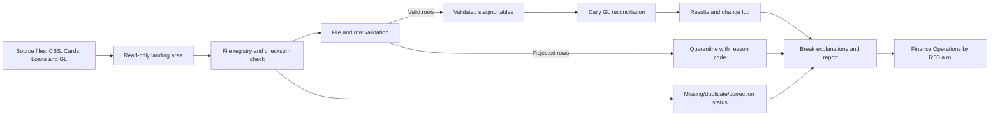
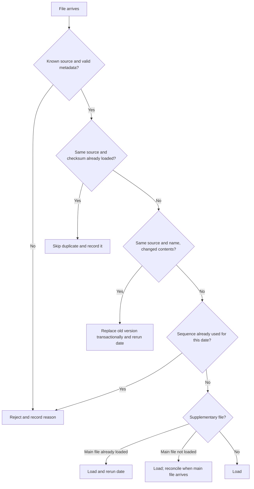

# GL Reconciliation — Design Notes

## What this system needs to do

Finance Operations needs a report by 7:00 a.m. each business day showing which GL codes do not balance, the size of each difference, and any known reason. The target is to send it by 6:00 a.m. and alert the on-call team by 6:30 a.m. if it has not gone out.

The main rule is that rerunning a date must not double-count transactions, and bad or missing data must not disappear without anyone knowing. This is the proposed end-to-end design. The project already has Python logic for file decisions and row validation, along with SQL for reconciliation, mapping overlaps, writing results and break trends. The file registry, persistent quarantine, job orchestration, report generation and alerts still need to be connected.

## 1. Architecture and data flow

Files are copied to a controlled landing area and kept unchanged, so the original input is available for audit. The pipeline then:

1. **Registers the file.** Calculate its checksum and decide whether to load it, skip it, reject it, or load it and rerun that date.
2. **Validates the data.** Check the file structure, then validate individual rows. Valid rows move forward; rejected rows are kept with a reason code.
3. **Reconciles the date.** Map accounts to GL codes, total debits and credits separately, and compare the source totals with the GL totals. The current SQL uses a ₹1.00 tolerance on each side.
4. **Explains and reports.** Show breaks, known causes, rejected-row counts, missing files and changes from the previous result.

The current code is built around Python and PostgreSQL. The bank's existing scheduler (for example, Control-M, cron or Airflow) should run the jobs; choosing a new scheduler is not a requirement of this design. Processing and model inference, if approved, stay inside the bank's network.

### File decision rules

These rules follow `src/file_actions.py`. If a file has the same name but different contents, it is treated as a correction. If a different file uses a sequence number that is already taken, it is rejected for someone to review. The decision function only decides what should happen; the loader still needs to perform the database changes safely.

## 2. Data model

The table below is the proposed production model. The SQL in this project uses `stg_txn`, `account_gl_map`, `gl_movement`, `recon_result` and `recon_change_log`. The registry, run-tracking and quarantine tables still need to be added and wired into the Python code.

| Layer | Table | Key | Purpose |
|---|---|---|---|
| Raw | Original file in landing storage | Source + checksum (registry reference) | Preserves the exact file received; do not edit it in place. |
| Control | `file_registry` | `file_id`; enforce uniqueness for source + checksum | Tracks every received file, including skipped, rejected, loaded and superseded versions. |
| Control | `run_log` | `run_id` | Records the date, trigger, start/end time and outcome of each run. |
| Control | `run_file` | `run_id` + `file_id` | Links each run to the exact files it used. |
| Validated | `stg_txn` | `source` + `txn_ref` | Valid transactions in rupees, with the originating `file_id`. |
| Validated | `gl_movement` | `gl_code` + `business_date` | GL debit and credit totals for a date. |
| Reference | `account_gl_map` | `map_id` | Account-to-GL mapping with `valid_from` and `valid_to` dates. |
| Quarantine | `quarantine_row` | `file_id` + `row_number` | Keeps the rejected row, reason code, review status and owner. |
| Reconciled | `recon_result` | `business_date` + `gl_code` | Latest result for each GL code and date, with its `run_id`. |
| Reconciled | `recon_change_log` | Add a generated key or define a composite key | Records result changes between runs. To show old and new amounts, the table must store those amounts; the current B3 SQL only writes old and new status. |
| Reporting | `break_explanation` | `business_date` + `gl_code` + `cause` | Holds the amount attributed to each explanation category. This is a proposed table; the current SQL does not populate it yet. |

The mapping query currently chooses the latest valid mapping when an account has more than one. That is a business rule, not a safe assumption by itself. Before production, the bank should confirm whether overlaps are allowed. If not, reject or flag overlapping mappings rather than silently choosing one. `sql/b2_overlaps.sql` identifies overlapping pairs; a database constraint should prevent new overlaps if that is the agreed rule.

## 3. Ingestion, duplicates and reruns

For a given date, reconciliation uses the files currently marked as loaded. If those files have not changed, rerunning the job should produce the same totals.

- **Duplicate file:** if the checksum matches a previously loaded file from the same source, record the arrival and skip the load. Do not add its rows again.
- **Corrected re-send:** if the source sends the same file name with different contents, mark the old version as superseded, remove its staged rows by `file_id`, load the new version and update the registry in one database transaction. Rerun that business date after the replacement commits. If the replacement fails, roll back the replacement rather than leave a half-loaded state.
- **Supplementary file:** load it as a separate file. If the main file for that date is already loaded, rerun that date; if not, wait until the main file arrives before reconciling.
- **Whole-day rerun:** reuse the staged data and rebuild the reconciliation result for that date. Do not reload the same files just because the reconciliation is rerun. Prevent two runs for the same date from writing at once, for example with a PostgreSQL advisory lock.
- **Duplicate transaction reference:** the database key `(source, txn_ref)` prevents the same source transaction from being staged twice. The loader must catch that conflict, quarantine or reject the offending row, and record why. The current project does not yet implement this loader behaviour.

Load each file as one transaction, preferably using PostgreSQL `COPY` for bulk loads. A file should not be marked `LOADED` until its accepted rows and control totals have been committed successfully.

## 4. Data quality and quarantine

Run checks as early as possible so invalid data does not reach reconciliation.

| Level | Checks | Action when a check fails |
|---|---|---|
| File | Known source, expected file name, required columns and supported column aliases | Hold or reject the whole file if required structure is missing; notify Operations. Log unexpected columns for review. |
| Row | Required values, positive amount, valid date, matching business date, INR currency where required, valid debit/credit indicator, ambiguous aliases | Store the raw row and reason code in quarantine; continue with valid rows unless the batch-level policy says to hold the file. |
| Batch | Reject rate, row count versus recent history, totals that suggest paise/rupee confusion, and amount held in unmapped accounts | Warn or hold the file according to thresholds agreed with the bank. Initial examples are a reject rate above 2% or row count more than 30% away from the recent seven-day average; these are starting assumptions, not proven thresholds. |

The current `src/row_validations.py` implements row-level normalization and checks, including amount conversion from paise to rupees, date and currency checks, and debit/credit normalization. File-level checks, batch thresholds, persisted quarantine records and notifications are not yet connected end to end.

Finance Operations should see the number and value of rejected rows by reason in the morning report. Data Support should receive the detailed quarantine list, with access limited to the people who need it. Fixes should come through a corrected source file or an approved correction workflow—not by silently editing staged rows.

## 5. Late files and changed results

A supplementary or corrected file for an earlier date triggers a rerun of that date. The new result is compared with the previous result, and only genuine changes should be written to the change log. The next report should include a **“Changed since last report”** section showing the GL code, previous and current status, and previous and current amounts.

The current `sql/b3_write_results.sql` logs changed statuses, but it does not store the old and new amounts in `recon_change_log`. To support the report described above, extend the table and insert statement to store those amounts (or store a reference to immutable run snapshots). A change to a date older than one business day should also trigger an email to Finance Operations because the earlier report may already have been used to make a decision.

Each report should show its `run_id`, business date and generation time. The bank must decide whether a late change can reopen a closed accounting period and who approves that action.

## 6. Reconciliation and break explanation

For each GL code and business date, B1 totals source debits and credits separately and compares them with the GL debit and credit totals. A result is `MATCHED` when both differences are within ₹1.00; otherwise it is `BREAK`. A full outer join keeps GL codes that appear on only one side, so missing source or ledger activity is not hidden.

The report should group known causes separately:

1. **Missing source file** — an expected file has not arrived by cut-off.
2. **Late-file effect** — a supplementary or corrected file changed the result.
3. **Quarantined rows** — rejected transactions that can be associated with an account/GL and whose readable amount can be estimated safely.
4. **Unmapped accounts** — shown as a day-level total if no GL code can be assigned reliably.
5. **Unexplained** — the remaining difference for Finance Operations to investigate.

These categories are part of the proposed report; they are not all implemented yet. The current SQL calculates reconciliation totals and an unmapped-account summary, but not all five explanation buckets. Before saying every rupee has been accounted for, the attribution rules need to be defined and tested so the same amount is not counted twice. The report should show explained amounts alongside the remaining unexplained difference.

## 7. Operations and the 7 a.m. deadline

These timings are a starting point. They need to be checked against actual file arrival times and the bank's business calendar.

| Time | Activity |
|---|---|
| 01:00–05:00 | Check the landing area every 10 minutes and load files as they arrive. |
| 04:30 | Alert Operations and the source owner for any expected file still missing. |
| 05:00 | Cut-off for the first report; list missing sources clearly. |
| 05:00–05:30 | Reconcile and prepare explanations. The 30-minute target at 50 million rows must be load-tested. |
| 06:00 | Build and send the report. |
| 06:30 | If the report has not been sent, page the on-call engineer and alert the Finance Operations head. |

Monitor file arrival, row counts and totals against recent history, reject rate, quarantine backlog, run duration and status, and report delivery. A missing-report check must run independently of the main pipeline so that a pipeline failure cannot prevent its own alert. Missing files and failed runs are high severity; a report not sent by 06:30 is critical; quality warnings and late changes are routed to the responsible support or Finance Operations team.

## 8. Scale from 2 million to 50 million rows per day

Start with PostgreSQL `COPY`, useful indexes and query plans measured on realistic data. If volumes increase, partition `stg_txn` by business date, resolve account mappings once for the date, load independent sources in parallel, and build the report from summary tables rather than scanning raw transactions. Older raw files can move to lower-cost storage once the retention policy allows it.

Do not introduce streaming, Spark, a data lake or a machine-learning anomaly detector just because the volume reaches 50 million rows. First load-test that volume with realistic data, indexes and concurrent activity. If PostgreSQL misses the agreed time window, use the test results to identify the bottleneck and then decide whether partitioning, query changes, more capacity or a different processing engine is warranted.

## 9. Audit and security

Every reported number should be traceable to `recon_result.run_id`, then through `run_file` and `file_registry` to the original file using its checksum. Each staged transaction should retain its `file_id`. Mapping changes should record who changed them, when, and the previous and new values. Keep run history and original files for the retention period approved by the bank.

Use separate service accounts for ingestion and reconciliation. Finance Operations can read results, explanations and change history, but not raw transaction rows by default. Data Support can review the file registry and quarantined rows. Administrative access to business data should be approved and logged. Encrypt data in transit and at rest, mask account identifiers in exports where appropriate, and log access to quarantined data. Exact permissions, masking rules and retention periods need the bank's security team's approval.

## 10. AI decision

AI is optional here. Since the main task is to perform validations and calculations on a schedule basis , AI is not neccesary . But AI model can be useful on analysing the trends of the mismatch on amounts and identify anomolies to help report them immediately . 

## Trade-offs and questions for the bank

**Trade-offs:** 
- **Reject a conflicting second file instead of guessing.** Safer for the numbers, but a person has to resolve it.
- **Keep reruns tied to a date.** Simple and idempotent, but it reprocesses the whole date even for a small supplementary file.
- **Delete vanished GL codes and log them,** rather than keep stale rows.

**Questions before build:**

1. What are the real arrival times and cut-off rules for each source, including holidays?
2. Can a closed period be changed by late data?
3. Are overlapping account-to-GL mappings ever valid, and who owns their resolution?
4. Which fields may Finance Operations see, and how long must raw files, quarantine rows and results be retained?
5. Which scheduler, alerting platform and PostgreSQL version are already approved?
6. Which definition of “unexplained break” does Finance Operations use today?
